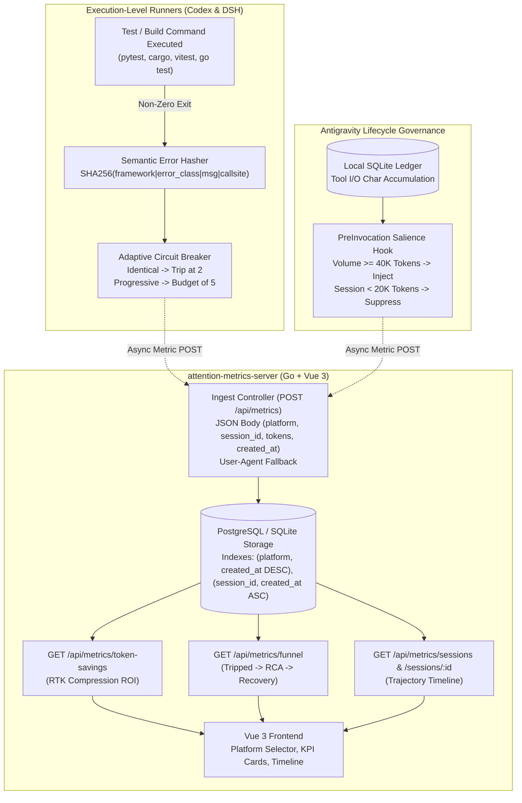

# Architecture & Technical Design: Adaptive Guard & Unified Metrics Dashboard

## 1. Architectural System Overview

The system unifies the execution hooks of Codex and DeepSeek Harness (`dsh`), the subagent lifecycle governance of Antigravity, and the centralized Go/Vue metrics server:



---

## 2. Component Design Details

### A. Semantic Error-Signature Hashing Engine (`REQ-AE-001`)

1. **Extraction Pipeline (`codex` and `dsh`)**:
   - Matches test and build runners: `pytest`, `cargo test`, `cargo build`, `cargo check`, `npm test`, `pnpm test`, `vitest`, `jest`, `go test`, `go build`, `mvn test`.
   - On non-zero exit code (`exit_code != 0`), parses stdout and stderr using framework regexes:
     - `pytest`: `(?:FAILED\s+)?(\S+?)::(\S+)\s+-\s+([A-Za-z0-9_]+Error|[A-Za-z0-9_]+Exception|AssertionError):\s*(.*?)(?:\s+at line \d+)?$`
     - `cargo`: `error(?:\\[(E\\d+)\\])?:\\s*(.*?)\\n\\s*-->\\s*([^:\\n]+):(\\d+)`
     - `vitest`/`jest`: `FAIL\s+(\S+)\s*>\s*([^\n]+)\n\s*(?:AssertionError|[A-Za-z0-9_]+Error):\s*(.*?)(?:\n\s*at\s+.*)?$`
     - `go test`: `--- FAIL:\s*(\S+)\s+\([^\)]+\)\s+([^:\n]+):(\d+):\s*(.*)`
     - Generic: first non-empty line of stderr (up to 120 chars).

2. **Canonicalization & Normalization**:
   - Strip ANSI escapes: `\x1b\[[0-9;]*[mK]` $\to$ `""`.
   - Strip memory addresses: `0x[0-9a-fA-F]+` $\to$ `"0xADDR"`.
   - Strip timing durations & timestamps: `(?:\d{4}-\d{2}-\d{2}[T ]\d{2}:\d{2}:\d{2}(?:\.\d+)?|\b\d+(?:\.\d+)?(?:ms|s|m|µs|ns)\b)` $\to$ `""`.
   - Strip trailing line numbers: `(?:\s+at line \d+|\s+at \S+:\d+:\d+)` $\to$ `""`.
   - Whitespace collapse: `\s+` $\to$ `" "` with `.strip()`.
   - Lowercase `framework` and `error_class`.

3. **Delimited Hashing**:
   ```python
   canonical_str = f"{framework}|{error_class}|{normalized_message}|{call_site}"
   error_signature = hashlib.sha256(canonical_str.encode("utf-8")).hexdigest()[:12]
   ```

4. **Circuit Breaker State Machine**:
   - `consecutive_same_sig_count: int` (tracks identical failures).
   - `progressive_failure_count: int` (tracks total consecutive failures across changing signatures).
   - `last_error_signature: str | None`.
   - **Transitions**:
     - Initial failure: `identical = 1`, `progressive = 1`, state becomes `FAILURE_STAGE_1`.
     - Identical failure (`error_signature == last_error_signature`):
       - `consecutive_same_sig_count += 1`
       - If `consecutive_same_sig_count >= 2`: transition immediately to `FAILURE_STAGE_2_TRIPPED`.
     - Divergent failure (`error_signature != last_error_signature`):
       - `consecutive_same_sig_count = 1`
       - `progressive_failure_count += 1`
       - `last_error_signature = error_signature`
       - If `progressive_failure_count >= 5`: transition to `FAILURE_STAGE_2_TRIPPED`.
       - Else: state remains `FAILURE_STAGE_1`.
     - Passing test execution (`exit_code == 0`):
       - `consecutive_same_sig_count = 0`
       - `progressive_failure_count = 0`
       - `last_error_signature = None`
       - State becomes `RECOVERY_VERIFIED`.

---

### B. Cumulative Tool I/O Token Salience Tracker (`REQ-AE-002`)

1. **Accounting Mechanism**:
   - In `antigravity-attention-guard-plugin`, each `PostToolUse` intercepts completed tool and subagent payloads.
   - Calculates character volume: $\Delta \text{chars} = \text{len(input\_json)} + \text{len(output\_json)}$.
   - Updates `session_stats` table in `attention_guard.db`:
     - `total_session_tokens += \lfloor \Delta \text{chars} / 4 \rfloor`
     - `tokens_since_refresh += \lfloor \Delta \text{chars} / 4 \rfloor`

2. **Salience Decision in `scripts/attention-refresh.py` (`PreInvocation`)**:
   ```python
   # Dynamic token volume trigger
   if tokens_since_refresh >= 40000:
       reset_refresh_counter(session_id)
       return emit_reminder()

   # Static turn modulo checkpoint (default: every 25 invocations)
   if invocation_num > 0 and (invocation_num % interval == 0):
       if total_session_tokens < 20000:
           return emit_empty()
       else:
           reset_refresh_counter(session_id)
           return emit_reminder()

   return emit_empty()
   ```

---

### C. Backend Ingest & Database Schema (`REQ-AE-003`, `REQ-AE-004`, `REQ-AE-005`, `REQ-AE-006`, `REQ-AE-007`)

1. **Database Schema & Migrations (`backend/main.go`)**:
   ```sql
   ALTER TABLE events ADD COLUMN IF NOT EXISTS platform VARCHAR(32) NOT NULL DEFAULT 'generic';
   ALTER TABLE events ADD COLUMN IF NOT EXISTS session_id VARCHAR(128) NOT NULL DEFAULT '';
   ALTER TABLE events ADD COLUMN IF NOT EXISTS raw_tokens INTEGER NOT NULL DEFAULT 0;
   ALTER TABLE events ADD COLUMN IF NOT EXISTS filtered_tokens INTEGER NOT NULL DEFAULT 0;

   CREATE INDEX IF NOT EXISTS idx_events_platform_time ON events(platform, created_at DESC);
   CREATE INDEX IF NOT EXISTS idx_events_session_time ON events(session_id, created_at ASC);
   ```

2. **Ingest Payload Contract (`POST /api/metrics`)**:
   - Supports single `IngestRequest` or batch `[]IngestRequest` (max 500 items).
   ```go
   type IngestRequest struct {
       EventType      string          `json:"event_type"`
       Platform       string          `json:"platform,omitempty"`
       SessionID      string          `json:"session_id,omitempty"`
       RawTokens      int             `json:"raw_tokens_est,omitempty"`
       FilteredTokens int             `json:"filtered_tokens_est,omitempty"`
       Reason         string          `json:"reason,omitempty"`
       Payload        json.RawMessage `json:"payload"`
       CreatedAt      *time.Time      `json:"created_at,omitempty"`
   }
   ```
   - Platform Resolution:
     1. If `req.Platform` in `("antigravity", "codex", "dsh")`, use as canonical platform.
     2. Else, inspect `User-Agent` (case-insensitive substring match):
        - contains `"antigravity"` $\to$ `"antigravity"`
        - contains `"codex"` $\to$ `"codex"`
        - contains `"dsh"` $\to$ `"dsh"`
     3. Else $\to$ `"generic"`.
   - Authentication: validates `X-API-Key` header against `os.Getenv("ATTENTION_METRICS_API_KEY")`.

3. **REST Query Endpoints**:
   - `GET /api/metrics?platform=...&session_id=...&event_type=...&limit=100`:
     Returns `[]Event` filtered by platform, session, or event type.
   - `GET /api/metrics/token-savings?range=7d&platform=all`:
     Calculates tokens saved ($\text{raw} - \text{filtered}$), savings percentage, and USD cost avoidance based on `os.Getenv("TOKEN_COST_PER_MILLION_USD")` (default $2.50).
   - `GET /api/metrics/funnel?range=7d&platform=all`:
     Aggregates distinct `session_id`s:
     - `tripped_sessions`: distinct sessions with `event_type = 'BREAKER_STATE_CHANGE'` and `payload.new_state = 'FAILURE_STAGE_2_TRIPPED'`.
     - `rca_authored_sessions`: distinct tripped sessions with `event_type = 'FILE_MODIFICATION'` for `diagnosis.md` or `rca.md`.
     - `recovered_sessions`: distinct tripped sessions with subsequent `event_type = 'BREAKER_STATE_CHANGE'` and `payload.new_state = 'RECOVERY_VERIFIED'`.
     - `recovery_rate_pct`: float percentage.
   - `GET /api/metrics/sessions?limit=50&platform=all`:
     Returns recent session summaries (session ID, platform, duration, event count, trip status).
   - `GET /api/metrics/sessions/:session_id`:
     Returns ordered array of events for the session trajectory (`created_at ASC`).

---

### D. Frontend Trajectory & Token Economics Dashboard (`REQ-AE-006`)

1. **Platform Selector Filter**:
   - Dropdown control in header: `[ All Platforms | Antigravity | Codex | DeepSeek Harness ]`. Emits reactive filter state updating all dashboard queries.
2. **Token Economics KPI Card**:
   - Displays: Total Raw Tokens, Tokens Delivered to Model, Net Tokens Saved by RTK, Compression Ratio (%), and Estimated Cost Savings ($).
3. **Circuit Breaker Funnel Card**:
   - Renders 3-step conversion funnel: Tripped Sessions $\to$ RCA Authored $\to$ Recovery Verified.
4. **Session Trajectory Timeline View**:
   - Interactive chronological list of turns rendering tool calls, exit codes, error signatures, breaker transitions, and recovery marks.
